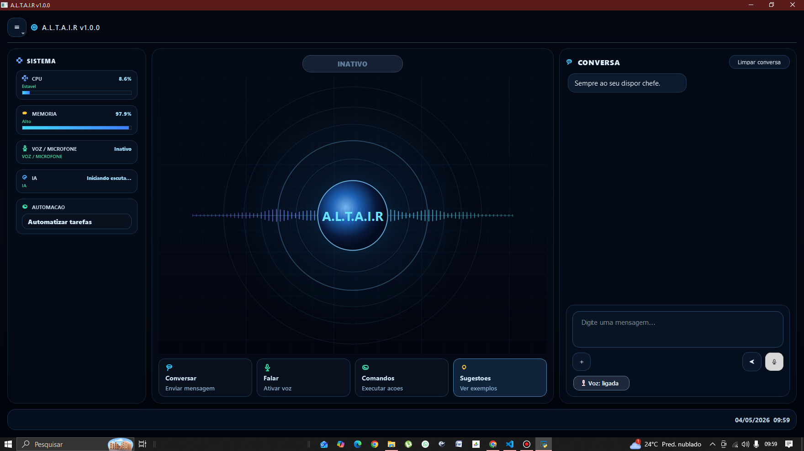

# Altair Assistant

Altair é um assistente de inteligência artificial open-source que combina interação por voz, automação do computador e ferramentas científicas em uma única plataforma. O objetivo do projeto é criar um assistente modular capaz de auxiliar em tarefas técnicas, aprendizado e experimentação com IA.

## Funcionalidades

- Interacao por voz: captura pelo microfone e transcricao exclusivamente via API remota; respostas por TTS (Piper/ElevenLabs).
- Chat desktop em tempo real com atalhos de midia (copiar resposta, anexar arquivos, pre-visualizacao de imagens).
- Automacao WhatsApp Web: envia audios gerados pelo próprio assistente, mensagens e arquivos, com pipeline interno (Piper -> ogg) e logs em `data/wwebjs_logs`.
- Automacao do sistema operacional: abre apps, executa comandos locais, realiza buscas web, abre sites e organiza arquivos.
- API remota (FastAPI) para controlar o Altair por dispositivos móveis.
- CAD/3D: gera arquivos 3D como engrenagens, sólidos geométricos, sistemas mecânicos, todo a partir de comandos em linguagem natural.
- Calculos avancados: resolver equacoes/sistemas, integrais, derivadas, graficos de funcao, encontrar raízes de equações, simulacoes fisicas (lancamento obliquo, oscilacao).
- Utilitarios de clima e geolocalizacao: temperatura, sensacao, vento, distancia entre cidades e mapa.
- Busca e uso de memoria de arquivos: extrai, resume e consulta conteudos de documentos locais.
- Configuracao de voz e modelos LLM pela interface; inicialização opcional com Windows.

## Interface



## Estrutura do projeto

```
.
+- src/
¦  +- altair/
¦     +- __main__.py
¦     +- main.py
¦     +- core/
¦     +- app/
+- scripts/
¦  +- whatsapp/
¦     +- teste.js
+- configs/
¦  +- apps.json
¦  +- groq_api_key.txt
¦  +- remote_api_token.txt
+- data/
¦  +- audios_temp/
¦  +- json/
¦  +- models/
¦  +- wwebjs_logs/
¦  +- ...
+- assets/
¦  +- piper/
+- requirements.txt
+- package.json
+- package-lock.json
```

## Microsoft Store / empacotamento

A pasta `store/` contém a base para empacotar o app em MSIX para a Microsoft Store, incluindo:

- `store/Altair.appxmanifest`
- `store/build_msix.ps1`
- `store/Assets/` com os ícones prontos para o pacote

Veja também: `store/README.md`.

## Como executar

### 0) Entry point seguro (sem mexer no main.py)

```bash
python run_altair.py
```

### 1) Python

```bash
pip install -r requirements.txt
python -m altair
```

### 2) WhatsApp Web (automacao)

O servidor `teste.js` inicia automaticamente quando necessario. Ele usa `scripts/whatsapp/teste.js` e grava logs em `data/wwebjs_logs`.

Se precisar rodar manualmente:

```bash
node scripts/whatsapp/teste.js
```

## Instalador offline (Python + bibliotecas embutidas)

O diretório `installer/offline_bundle/` inclui:

- Python 3.10.0 para Windows x64
- todas as wheels do projeto em `installer/offline_bundle/wheels`

O instalador usa esse cache automaticamente quando ele existe, instalando as dependências com `--no-index --find-links`, sem precisar acessar a internet durante a instalação. Para regenerar o bundle local, execute:

```powershell
powershell -ExecutionPolicy Bypass -File .\installer\build_offline_bundle.ps1
```

## Configuracao

- `configs/apps.json`: apps registrados
- `configs/groq_api_key.txt`: API key
- `configs/remote_api_token.txt`: token remoto
- `data/json/*.json`: configs do app/LLM/voz
- `json/voice_config.example.json`: exemplo seguro de configuracao de voz (copie para `json/voice_config.json` localmente)

Variaveis de ambiente:

- `ALTAIR_WWEBJS_DIR` (padrao: `scripts/whatsapp`)
- `ALTAIR_CHROME_PROFILE_DIR` (padrao: `data/chrome_profile`)
- `ALTAIR_DATA_DIR` (padrao: `data`)
- `ALTAIR_STT_REMOTE_URL` (opcional): endpoint de transcricao remota compatível com OpenAI, ex.: `https://api.groq.com/openai/v1/audio/transcriptions`
- `ALTAIR_STT_REMOTE_API_KEY` (opcional): chave da API remota gratuita ou limitada
- `ALTAIR_STT_REMOTE_MODEL` (opcional): modelo usado pela API, ex.: `whisper-1` ou `distil-whisper-large-v3-en`
- `ALTAIR_STT_REMOTE_LANGUAGE` (opcional): idioma da fala, padrao `pt`
- `ALTAIR_STT_REMOTE_TIMEOUT` (opcional): timeout em segundos, padrao `60`

O reconhecimento de fala usa exclusivamente a API remota configurada; nao ha modelo local de transcricao. Configure a chave e o endpoint do provedor em Configurar Voz.

## Observacoes

- Pastas `data/` e `dist/` sao artefatos locais e ficam fora do git.
- Nunca commite chaves reais (`GROQ`, `OpenAI`, `ElevenLabs`) ou tokens em JSON/TXT.
- Para CAD/3D, configure as bibliotecas em `G:\bibliotecas` (cq_gears, cq_warehouse, cqparts).
- O entrypoint recomendado e `main_entry.py`; `main.py` e legado.

---

